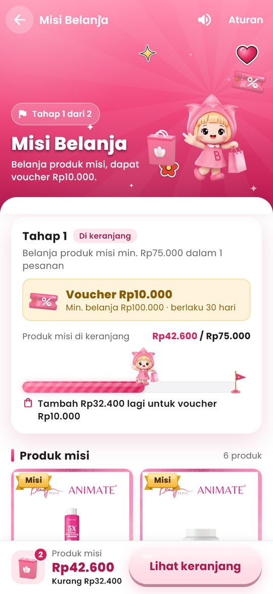
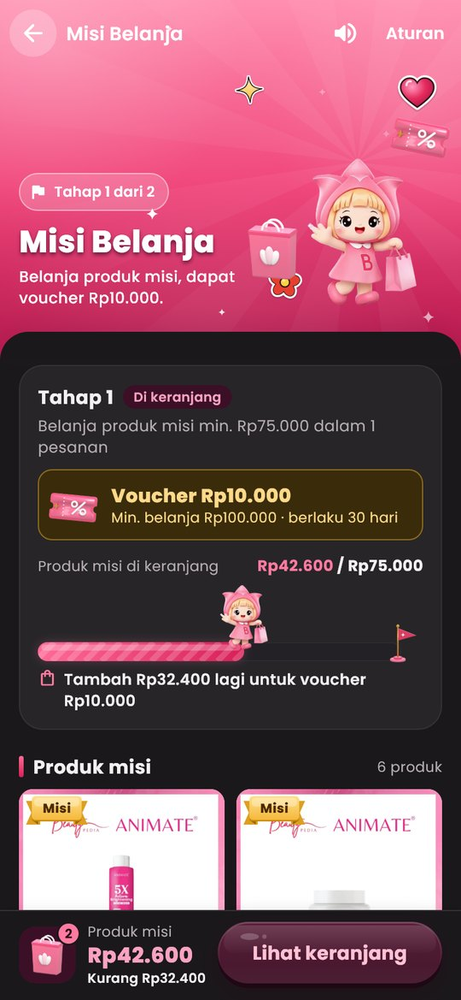
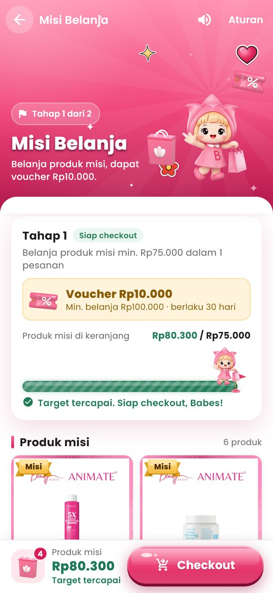
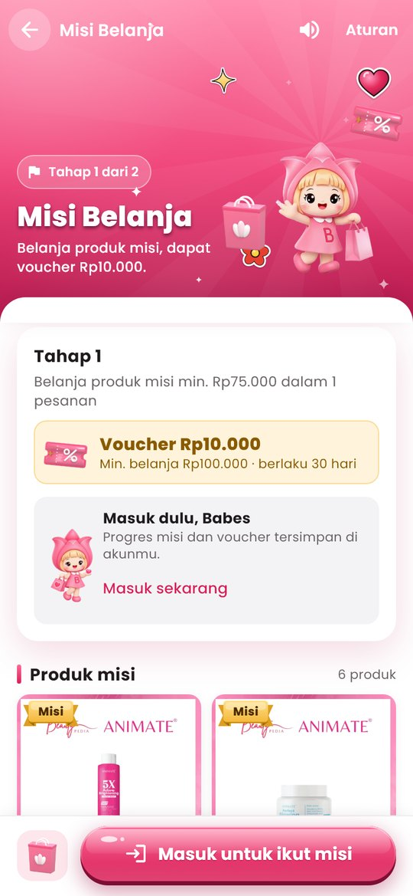
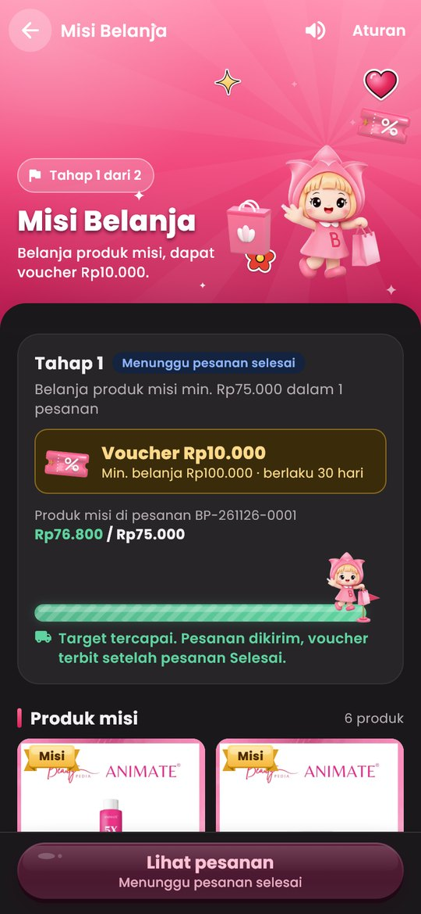
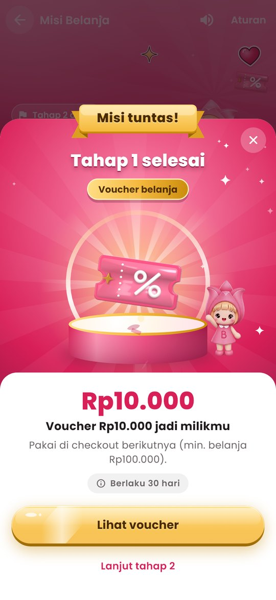
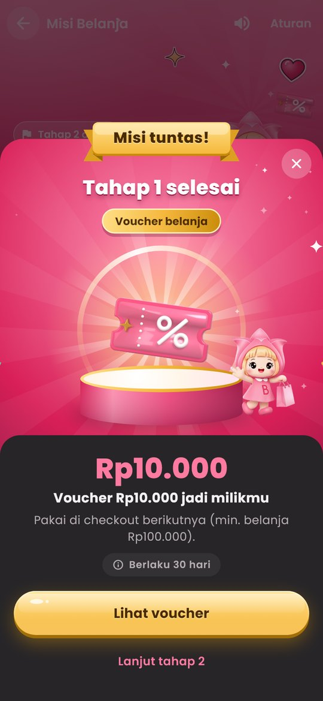
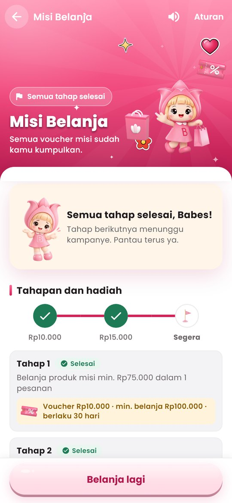

# misi_belanja · Misi Belanja v3

Modul game **Misi Belanja** untuk Bpedia Demo v3: belanja produk misi dalam satu pesanan, capai target subtotal, dapat voucher belanja bertahap.

Isi paket:

- **Aturan murni** (Dart tanpa I/O): tahap misi, subtotal produk misi, penilaian pesanan, voucher (terbit, pakai, lepas saat batal, kedaluwarsa).
- **Halaman siap pakai** `MissionsPage`: hero pesta dengan Bipy berjalan, kartu tahap aktif dengan kupon hadiah dan bar progres beranimasi, grid produk misi dengan tambah cepat dan stepper, tangga tahap, voucher milik pengguna, cara main, bar bawah menempel, lembar perayaan saat tahap tuntas.
- **Aset** milik modul: sprite Bipy (`bipy_jalan`, `bipy_sapa`), pose diam (`belanja`, `pesta`, `semangat`), seni 3D (`bag`, `ticket`, `flag`, `coin`), stiker (`hati`, `kilau`, `bunga_merah`, `senyum`, `bintang`).
- **`example/`**: app kecil dengan `LocalMissionController` dan panel uji.

Hanya bergantung pada Flutter SDK. Suara dimainkan host lewat `GameCue`; getar dipanggil kit.

| Di keranjang (terang) | Di keranjang (gelap) | Siap checkout | Tamu |
|---|---|---|---|
|  |  |  |  |

| Menunggu pesanan selesai | Misi tuntas | Misi tuntas (gelap) | Semua tahap selesai |
|---|---|---|---|
|  |  |  |  |

Halaman penuh tahap 2 (gelap) dan teks 200% di lebar 360: `docs/shots/misi_tahap2_gelap.jpg`, `docs/shots/misi_teks200.jpg`. Strip animasi: `docs/shots/misi_strip_tambah.jpg` (tas terbang ke keranjang, angka naik, bar penuh, konfeti) dan `docs/shots/misi_strip_tuntas.jpg` (kupon jatuh memantul, konfeti, Bipy berjalan lalu melambai).

## Aturan singkat

- Tiap tahap punya target subtotal **produk misi** (`MissionStage.productCodes`; kosong = semua produk) dalam **satu** pesanan yang **Selesai**.
- Satu pesanan menyelesaikan paling banyak satu tahap; pesanan yang sama tidak dihitung dua kali.
- Tahap tuntas menerbitkan voucher (nominal, min. belanja, masa berlaku hari). Tahap berikutnya terbuka setelah voucher tahap sebelumnya terbit.
- Subtotal dihitung dari harga barang sebelum potongan Kelopak, tanpa ongkir.
- Nilai contoh `demoMissionStages` **(demo)**: tahap 1 min. Rp75.000 → voucher Rp10.000 (min. belanja Rp100.000, 30 hari); tahap 2 min. Rp100.000 → voucher Rp15.000 (min. belanja Rp150.000, 30 hari). Daftar produk misi diisi host (`bpedia-app/lib/config/demo_campaign.dart`).

## Pemasangan

```yaml
dependencies:
  misi_belanja:
    path: ../bpedia-misi-belanja
```

Aset modul dirujuk dengan `package: 'misi_belanja'` dan sudah terdaftar di `pubspec.yaml` paket. Font mengikuti tema host (Bpedia memakai Poppins).

## Pemakaian

Pola: aturan murni → `MissionViewState` tak-berubah → `MissionController` abstrak (`ChangeNotifier`) → `MissionsPage`. Halaman tidak tahu sumber data.

```dart
import 'package:misi_belanja/misi_belanja.dart';

// Contoh dan tes: pengendali dalam memori.
final controller = LocalMissionController(
  stages: stages,                       // MissionStage dengan productCodes
  today: wibDay,                        // hari WIB (hari sejak 1970-01-01)
  stageProducts: {0: stageOne, 1: stageTwo},
  soundOn: true,
);

Navigator.of(context).push(MaterialPageRoute<void>(
  builder: (_) => MissionsPage(controller: controller),
));
```

Host sungguhan (hub `kelopak_hub`) membuat subkelas `MissionController` di atas mesinnya:

```dart
class HubMissionController extends MissionController {
  @override
  MissionViewState get state => MissionViewState(
    signedIn: host.isLoggedIn,
    stages: campaign.missionStages,
    issuedCount: engine.missionIssuedCount,
    today: clock.wibDay,
    products: [for (final code in activeStage.productCodes) toMissionProduct(host.productOf(code))],
    cartLines: [for (final l in host.cartLines) MissionOrderLine(productCode: l.code, unitPrice: l.price, quantity: l.qty)],
    vouchers: engine.missionVouchers,
    pendingOrder: engine.pendingMissionOrder,   // pesanan yang sudah memenuhi target
    celebration: engine.unseenMissionCelebration,
    soundOn: settings.soundOn,
  );
  // refresh, addToCart, setQuantity, acknowledgeCelebration, open*, useVoucher, setSoundOn, playCue
}
```

## API

### Data tampilan dan keadaan (`mission_view.dart`)

| Simbol | Isi |
|---|---|
| `MissionProduct({code, name, image, price, strikePrice?, category?, maxQuantity?})` | Produk misi sebagai data tampilan (`ImageProvider` dari host). `discountPercent` dihitung dari harga coret. |
| `MissionPendingOrder({orderId, missionSubtotal, statusLabel?})` | Pesanan yang memenuhi target tahap aktif dan menunggu Selesai. |
| `MissionCelebration({stage, voucher, nextStage?})` | Tahap yang baru tuntas dan belum dirayakan. |
| `enum MissionPhase { notStarted, inCart, ready, awaitingCompletion, allDone }` | Fase tahap aktif. |
| `MissionViewState({required signedIn, required stages, required issuedCount, required today, products, cartLines, vouchers, pendingOrder, celebration, soundOn, busy})` dan `MissionViewState.guest({required stages, required today, products, cartLines, soundOn})` | Keadaan halaman. Turunan: `activeIndex`, `activeStage`, `allDone`, `progress` (`missionProgress` atas `cartLines`), `phase`, `quantityOf(code)`, `categories`, `activeVoucherCount`, `statusOf(index)`, `copyWith(... clearPendingOrder, clearCelebration)`. |
| `abstract class MissionController extends ChangeNotifier` | `state`, `refresh()`, `Future<bool> addToCart(code)`, `setQuantity(code, qty)`, `acknowledgeCelebration()`, `openLogin()`, `openShop()`, `openCart()`, `openCheckout()`, `openProduct(code)`, `openOrder(orderId)`, `openVouchers()`, `useVoucher(voucherId)`, `setSoundOn(on)`, `playCue(GameCue)`. |
| `LocalMissionController({required stages, required today, products, stageProducts, signedIn, issuedCount, cart, vouchers, soundOn, latency})` | Pengendali memori. Simulasi: `signIn`, `signOut`, `setToday`, `placeOrder`, `shipOrder`, `completeOrder`, `cancelOrder`, `clearCart`, `reset`; `log` mencatat navigasi dan cue; `openOrderId`, `openOrderStatus`. |

### Halaman dan widget

| Simbol | Isi |
|---|---|
| `MissionsPage({required controller, title = 'Misi Belanja', onBack, showBack = true})` | Halaman lengkap (SPEC-V3 §6.3). |
| `showMissionCompleteSheet(context, {required celebration, required onSeeVoucher, onNextStage})` | Lembar "Misi tuntas" (kit `ResultSheet`); dipakai halaman dan bisa dipakai hub. |
| `MissionLadder({required stages, required issuedCount, pendingNote, activeStatus, activeTone})` | Jalur tahap horizontal + kartu tiap tahap (target, kupon hadiah, status). |
| `VoucherCard({required voucher, required today, onUse})` | Kupon tiket voucher misi; status Aktif/Terpakai/Kedaluwarsa; stub pindah ke atas pada huruf besar. |
| `MissionProgressTrack({required progress, required label, required message, messageIcon, success, showWalker})` | Bar progres tebal, Bipy berjalan di ujung isian, bendera target, denyut saat bertambah. |
| `MissionProductCard({required product, required quantity, required onAdd, required onQuantityChanged, onOpen, addButtonKey})`, `QtyStepper` | Kartu produk marketplace berpita "Misi" dengan tambah cepat / stepper. |
| `MissionHowTo({required targetLabel})`, `StatusPill`/`StatusTone`, `LivelyPose`, `TicketDrop`, `MissionWaveCompanion` | Pelengkap. |
| `MissionArt`, `MissionSprites` | Aset modul. |

### Aturan murni

`MissionStage`, `demoMissionStages`, `StageStatus`, `stageStatus`, `allStagesDone`, `evaluateOrder`, `MissionDecision`, `OrderRejection`, `MissionOrderLine`, `missionSubtotal`, `evaluateOrderLines`, `MissionProgress`, `missionProgress`, `MissionVoucher` (`issue`, `markUsed`, `release`, `fromJson`/`toJson`), `RedeemProblem`, `redeemProblem`, `rupiah`, `formatWibDateShort`, `formatWibDateLong`, `GameCue`.

## Perilaku halaman

- **Tamu**: halaman tetap tampil (target, hadiah, produk), progres disembunyikan, bar bawah "Masuk untuk ikut misi". Tambah ke keranjang tetap boleh.
- **Tambah ke keranjang**: cue `tap`, tiga tas terbang ke ringkasan keranjang di bar bawah, angka naik, bar progres mengisi dan berdenyut. Gagal (batas jumlah) → cue `softError` + pesan lembut.
- **Target tercapai**: bar dan teks berubah hijau, konfeti, cue `bonus`, pengumuman pembaca layar, tombol "Checkout" berdenyut.
- **Menunggu pesanan selesai**: bar penuh dengan subtotal pesanan, catatan nomor dan status pesanan, tombol "Lihat pesanan".
- **Tahap tuntas** (`state.celebration`): lembar perayaan sekali (`acknowledgeCelebration`), cue `missionDone`, aksi "Lihat voucher" (gulir ke voucher) dan "Lanjut tahap N".
- **Semua tahap selesai**: kartu Bipy menyemangati; grid disembunyikan; "Belanja lagi".
- **Kurangi gerak** (`MediaQuery.disableAnimations`): bar langsung ke nilai akhir, sprite di frame pertama, pose diam, konfeti diganti taburan diam (kit).
- Teks tahan skala 200% di lebar 360 (diuji untuk lima keadaan), target sentuh ≥ 48, Semantics pada progres, kartu tahap, tombol, voucher.

## Pengembangan

```bash
flutter analyze
flutter test --concurrency=3            # semua tes
flutter test --concurrency=3 test/shots # tangkap layar ke build/shots/
cd example && flutter test              # tes app contoh
php -d extension=pdo_sqlite server/missions.php   # swa-uji server referensi
```

`example/` hanya berisi kode Dart, aset, dan `pubspec.yaml`; buat runner sekali dengan `flutter create --platforms=web,android .` di dalam `example/` bila ingin menjalankannya. Tombol kembali halaman contoh membuka panel uji (masuk/keluar, checkout/kirim/selesai/batal, ganti hari, tema gelap, kurangi gerak).

`lib/src/kit/` adalah salinan identik kit pesta dari `bpedia-asset-build/v3/kit_src` (jangan diubah per modul; dikecualikan dari analyzer modul).
